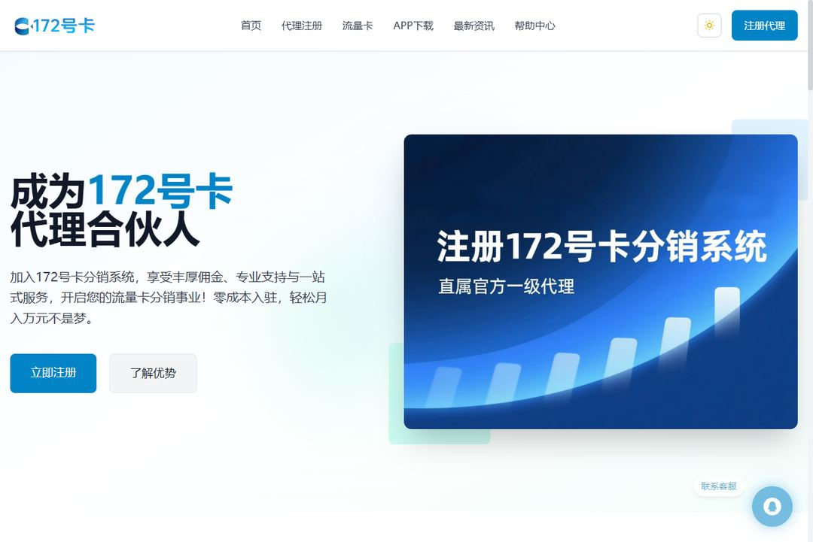

# 172号卡邀请码获取与使用指南

> 面向新注册用户与代理的邀请码说明：邀请码是多少、在哪里获取、怎么填写、一级代理邀请码 2026 版注意事项。

## 这份指南解决什么问题

注册 172 号卡分销系统时，系统会要求填写邀请码（也叫推荐码、推荐人号码），不少新用户会卡在这一步。本指南按四种常见场景整理：

| 场景 | 你需要做的 |
| --- | --- |
| 注册时被要求填邀请码，不知道填什么 | 从官方代理入驻页获取，见下文「获取方式」 |
| 不知道邀请码填在哪里 | 注册页的「邀请码 / 推荐人」输入框，与手机号验证码在同一张表单 |
| 想成为一级代理 | 使用一级代理邀请码注册，开通分销权限 |
| 想知道邀请好友有什么奖励 | 登录代理后台查看「邀请奖励」板块 |

## 获取方式

1. 打开官方代理入驻页：[ka172.cn/agent](https://www.ka172.cn/agent)
2. 按页面指引完成注册，邀请码字段随注册流程一并填写
3. 提交后即可开通账号，进入后台选品推广

> 提示：邀请码只与注册入口绑定，请通过官方站点获取，避免使用来路不明的第三方页面。

## 常见问题

**邀请码和推荐码是一回事吗？**
是。不同页面叫法不同：邀请码、推荐码、推荐人号码，指的都是注册时填写的同一串代码。

**一级代理邀请码和普通邀请码有什么区别？**
普通邀请码用于注册成为分销商；一级代理邀请码对应更高的起点权限，具体权益以后台展示为准。

**填错了怎么办？**
邀请码与账号绑定后通常不可更改，注册前请核对清楚；如已填错，联系平台客服处理。

**2026 年邀请码政策有变化吗？**
平台政策会不定期调整，以官方页面最新说明为准。

## 相关资源

- [172号卡分销系统官网](https://www.ka172.cn/)
- [代理入驻入口](https://www.ka172.cn/agent)
- [流量卡挑选指南（姊妹仓库）](https://github.com/haoka172/172-card-guide)
- [GitHub 主页](https://github.com/haoka172)
